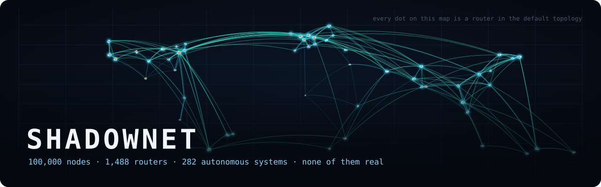
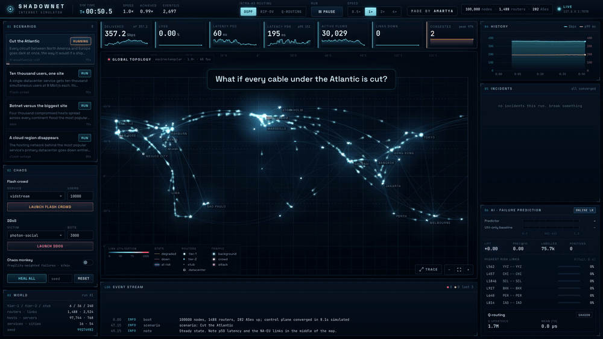
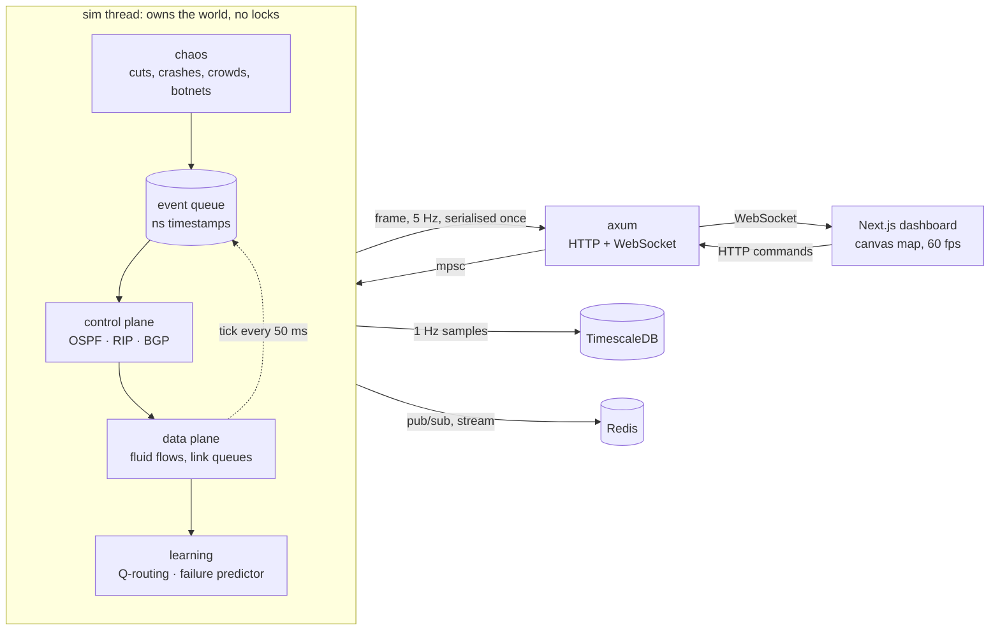

<p align="center">
  
</p>

<p align="center">
  <b>A hundred thousand machines that don't exist, routing traffic that was never sent,<br>
  failing in ways that teach you how the real internet survives.</b>
</p>

<p align="center">
  <a href="#run-it-in-sixty-seconds">Run it</a> ·
  <a href="#what-you-can-ask-it">Experiments</a> ·
  <a href="#how-it-works">How it works</a> ·
  <a href="#numbers">Numbers</a> ·
  <a href="docs/DESIGN.md">Design notes</a> ·
  <a href="docs/PROTOCOL.md">API</a>
</p>

<p align="center">
  
  
  
  
  
</p>

---

<p align="center">
  
  <br>
  <sub>Full demo with captions: <a href="media/shadownet-demo.mp4"><code>media/shadownet-demo.mp4</code></a></sub>
</p>

## What is this

ShadowNet is an internet in a box. It generates a planet's worth of networks:
tier-1 backbones with points of presence on every continent, regional
carriers, eyeball ISPs, datacenters, and about 98 000 hosts. Then it runs
real routing protocols over them: OSPF-style link state inside every network,
BGP between them, a distance-vector protocol for contrast, and a
reinforcement-learning router that learns from measured delay. You can cut
cables, crash routers, take a cloud region offline, aim a botnet at a website
or send ten thousand people to it at once, and watch every packet's
consequences on a live map.

None of it is scripted. Convergence times, micro-loops, black holes, BGP path
hunting, queues filling and draining: all of it falls out of the simulation.

## What you can ask it

Each of these is a scenario you can launch from the dashboard or run headless
(`shadownetd run <name>`). The numbers are from the default seed.

| Question | Scenario | What happens |
|---|---|---|
| What if someone cuts every cable under the Atlantic? | `transatlantic-cut` | 17 circuits go dark. Loss spikes to 14.7% for one tick; within a second every backbone has rerouted the long way round through Asia and the Pacific. Nothing stays unreachable. Tail latency pays: p99 191 → 225 ms. |
| What do ten thousand users do to one website? | `flash-crowd` | 80 Gbit/s of demand lands on a single datacenter. Its busiest uplink saturates, the buffer fills to its 50 ms limit and stays there. Under OSPF 78% of the crowd's traffic is dropped, and 7.1% of everyone else's on the way. Switch forwarding to Q-routing mid-crowd and it spreads load over the other paths: crowd loss 65%, 14 Gbit/s more delivered, collateral loss 6.0%. |
| What happens when a cloud region disappears? | `cloud-outage` | The hosting network withdraws from BGP everywhere; health-checked replica selection moves new users to the surviving datacenters and their uplinks take the load. |
| Is shortest-path routing good enough? | `brownout` | Europe–Asia circuits get 120 ms slower but stay up. OSPF does not notice; nothing changed in its world. Q-routing measures the delay and steers around it where the topology allows: mean latency 92.8 → 76.2 ms, p99 380 → 220 ms. |
| How bad is RIP, really? | `router-crash` | The busiest core router dies twice: once under link state (SPF reconverges in a few hundred ms), once under distance vector (periodic updates, counting toward infinity). |
| Can you see a failure coming? | `chaos-monkey` | Links fail on their own, more often when hot or flappy. An online model learns from every failure after the fact. After a few minutes it ranks links at AUC 0.83–0.89, against 0.43–0.58 for alerting on utilisation, and about half of its top-10 warnings are followed by a real failure within 20 s. |
| What does losing a tier-1 look like? | `tier1-down` | The provider with the most customers vanishes. Single-homed customers go dark; everyone else explores alternative AS paths until BGP settles. |
| What does a DDoS do to the bystanders? | `ddos` | Four thousand bots at 25 Mbit/s each. The interesting damage is not at the target, it is in the access networks the bots live in. |

## Run it in sixty seconds

You need Rust (1.85+) and Node (20+).

```bash
git clone https://github.com/amartya1523/ShadowNet && cd ShadowNet
(cd dashboard && npm ci && npm run build)
cargo run --release -p shadownetd
```

Open <http://127.0.0.1:7070>. That's the whole stack: one binary serving the
simulation, the API and the dashboard.

With metrics going to TimescaleDB and Redis as well:

```bash
docker compose -f deploy/docker-compose.yml up --build
```

No browser at all:

```bash
cargo run --release -p shadownetd -- run transatlantic-cut
cargo run --release -p shadownetd -- bench --suite crowd
```

## How it works



### The one idea that makes 100 000 nodes cheap

A packet-level simulator moving a few hundred Gbit/s needs tens of millions
of events per simulated second. Nobody runs that in real time on a laptop.
But none of the questions above need per-packet fidelity on every wire. They
need **exact routing state** and **realistic aggregate load**. So ShadowNet
splits the world:

- **The control plane is discrete-event and exact.** Every LSA, every BGP
  update, every SPF run is an event with a nanosecond timestamp. Failure
  detection takes 150 ms. LSAs flood hop by hop at the speed of light in
  glass. SPF is throttled. FIBs take 20 ms to program. BGP batches behind MRAI
  timers. Convergence is measured, not assumed.
- **The data plane is a fluid model.** Every 50 ms each flow walks hop by hop
  through the forwarding table *of each router it actually visits*, adds its
  rate to every link it crosses, and every link integrates its queue:
  `backlog += (offered − capacity) · dt`, clamped to the buffer. Queueing delay
  is `backlog / capacity`. Loss is what overflows.

Because flows consult each router's own, possibly stale FIB, a network
mid-convergence produces real micro-loops and black holes. They are counted,
shown on the map, and charged to the incident that caused them. That
property is the reason this project exists.

### The life of a packet in ShadowNet

Say a user in Mumbai is watching a video served from Frankfurt.

1. `traffic.rs` creates the flow: server → user, 11 Mbit/s, about 30 s,
   capped by the user's access line. The replica was chosen the way GeoDNS
   would choose it: nearest live datacenter.
2. Every tick, `forward.rs` walks it. In the datacenter's AS, BGP's best
   route to the user's AS says "leave via AS 64519". The IGP target is
   therefore *exit to AS 64519*, and this router's FIB row says which link
   gets there (hot-potato: the nearest border).
3. In each transit AS the same thing repeats with that AS's BGP choice and
   that router's FIB. If a router on the way has not heard about a failure
   yet, the walk follows its stale entry, perhaps straight into a dead link
   (black hole) or back where it came from (loop, caught by TTL 64).
4. The flow's rate lands on every directional queue it crossed. `links.rs`
   integrates them all. If a queue is past capacity, it fills; at 50 ms of
   buffer it starts dropping.
5. The flow's latency is the sum of propagation, queueing and injected delay
   along its path; its throughput is demand × Π(1 − loss). Percentiles in the
   dashboard are weighted by delivered bits, i.e. what the average bit feels.

## The five hard parts

**1. A hundred thousand nodes.** ~1 500 routers run full protocol state
machines; ~98 000 hosts are logical endpoints behind them with access rates.
Topology generation plus initial convergence of every protocol takes about
0.1 s, and the default world runs at ~34× real time on one core. See
[Scale](#scale).

**2. Routing from scratch.** No routing library anywhere.
[`algo/dijkstra.rs`](crates/shadow-graph/src/algo/dijkstra.rs) computes FIB
rows directly (first hop tracked during the search, not by walking parents
afterwards).
[`algo/bellman_ford.rs`](crates/shadow-graph/src/algo/bellman_ford.rs) finds
negative cycles and is the reference the distributed protocol is tested
against. [`igp/linkstate.rs`](crates/shadow-sim/src/igp/linkstate.rs) is OSPF:
sequence numbers, reliable flooding, LSDB sync on adjacency, the two-way
check, SPF throttling, fight-back after a reboot.
[`igp/distvec.rs`](crates/shadow-sim/src/igp/distvec.rs) is RIP with split
horizon and poisoned reverse. [`bgp.rs`](crates/shadow-sim/src/bgp.rs) is a
path-vector protocol with Gao-Rexford policies (customer > peer > provider,
valley-free export), MRAI batching and session epochs so stale updates from a
flapped session are recognised. The integration tests check that OSPF lands
on Dijkstra's answer, RIP on Bellman-Ford's, and that every BGP path in the
converged network is valley-free.

**3. A learning router.** [`brain/qrouting.rs`](crates/shadow-sim/src/brain/qrouting.rs)
is Boyan & Littman's Q-routing: each router learns the expected delivery time
to every target through every neighbour, from delays it actually measures,
queueing included. Two changes make it usable on a real topology: flows
pick among near-best next hops with a soft-min (so load spreads instead of
herding), and only *feasible* next hops are eligible, meaning the neighbour's
estimate must be strictly lower than ours. That is EIGRP's feasibility
condition, and it keeps the learner loop-free. It learns all the time in the
background, so switching to it mid-incident is instant.

**4. A failure simulator.** Operator actions (cut, crash, take an AS down,
inject delay or loss), traffic events (flash crowds, botnets) and a chaos
monkey. The monkey's first version was a plain hazard process, and it turned
out to be unpredictable by construction (the story is in
[DESIGN.md](docs/DESIGN.md#6-chaos)). Now most failures are *wear-out*: a
circuit's bit-error rate climbs for 20–80 s before it drops, and a quarter
of those episodes recover on their own. The rest are sudden, with no warning.
How often wear starts depends on hidden fragility plus stress an operator
can see (sustained load, recent flaps). It is synthetic, and that is said
plainly here. The [failure predictor](crates/shadow-sim/src/brain/predictor.rs)
never sees the wear state, only the counters a NOC would: online logistic
regression over eleven features. Every feature vector waits until its 20 s
horizon has passed before it is labelled and trained on, so every reported
score is out-of-sample.

**5. Seeing it.** The dashboard draws ~2 500 links and ~1 500 routers on a
canvas at 60 fps, with a few hundred flows animated as packets along their
real current paths. Frames arrive at 5 Hz and are interpolated. Click a link
to cut it, a router to crash it, two routers to traceroute between them
through the live forwarding state.

## Numbers

All from `shadownetd bench` (full output in [`bench/RESULTS.md`](bench/RESULTS.md)).
Simulated quantities are deterministic for a seed; only the wall-clock
columns depend on the machine (an 8-core Apple laptop here, using one core).

### Scale

| nodes | routers | ASes | links | flows | boot | events/s | speed |
|---:|---:|---:|---:|---:|---:|---:|---:|
| 25000 | 465 | 75 | 819 | 7603 | 0.04 s | 106430 | 120.2x |
| 50000 | 808 | 144 | 1404 | 15099 | 0.08 s | 95492 | 64.0x |
| 100000 | 1488 | 282 | 2524 | 30185 | 0.10 s | 90723 | 34.0x |
| 200000 | 2769 | 558 | 4769 | 59984 | 0.22 s | 63508 | 13.0x |

One thread, no GPU. The cost is dominated by flows walking forwarding tables,
so it grows with flows times path length, not with hosts.

### Reconvergence after a backbone cut

The 20 busiest backbone links, cut one at a time:

| routing | IGP median | IGP p90 | IGP max | peak loss (mean) | broken flow-s (total) |
|---|---:|---:|---:|---:|---:|
| OSPF (link-state) | 277 ms | 319 ms | 323 ms | 5.67% | 23934.1 |
| RIP (distance-vector) | 1429 ms | 2050 ms | 2267 ms | 4.99% | 26816.0 |
| Q-routing (RL) | n/a | n/a | n/a | 6.79% | 25693.9 |

Link state settles in a little under 300 ms, about half of which is failure
detection. Distance vector needs its periodic updates and takes five times
as long. The broken-flow totals are similar because most of the damage
happens in the first 150 ms, before *any* protocol knows; that is what fast
detection (BFD) and pre-computed backup paths (LFA) exist for.

### Flash crowd

| routing | delivered | network loss | p99 latency | crowd loss | crowd mean latency | background loss |
|---|---:|---:|---:|---:|---:|---:|
| OSPF (link-state) | 350.8 Gbps | 20.03% | 206 ms | 78.2% | 150 ms | 7.06% |
| RIP (distance-vector) | 350.8 Gbps | 20.03% | 219 ms | 78.2% | 154 ms | 7.06% |
| Q-routing (RL) | 364.8 Gbps | 16.85% | 210 ms | 65.4% | 151 ms | 6.03% |

80 Gbit/s of new demand against a datacenter whose BGP-preferred uplink is
40 Gbit/s: most of it cannot fit whatever you do. Q-routing cannot change the
BGP decision either, but inside each network it spreads load across parallel
paths and exits instead of piling everything onto the hot-potato choice, so
it delivers 14 Gbit/s more and hurts the bystanders less.

### Brownout

| routing | mean latency before | mean latency during | p99 during |
|---|---:|---:|---:|
| OSPF (link-state) | 64.9 ms | 92.8 ms | 380 ms |
| RIP (distance-vector) | 68.2 ms | 94.8 ms | 385 ms |
| Q-routing (RL) | 65.8 ms | 76.2 ms | 220 ms |

The clearest win for learning from measurements: OSPF's world did not change,
so it keeps forwarding into the slow circuits.

### Failure prediction

| minute | AUC | utilisation-only AUC | precision@10 | labelled | positives |
|---:|---:|---:|---:|---:|---:|
| 3 | 0.891 | 0.453 | 0.400 | 402892 | 1533 |
| 6 | 0.849 | 0.427 | 0.525 | 855254 | 4064 |
| 9 | 0.856 | 0.549 | 0.512 | 1308043 | 6430 |
| 12 | 0.850 | 0.498 | 0.581 | 1760762 | 8659 |
| 15 | 0.827 | 0.576 | 0.505 | 2213234 | 10985 |

Base rate is about 0.5% of link-seconds, so a precision@10 of 0.5 is roughly
a hundredfold lift over guessing. The model leans on interface errors and
their trend, as an operator would. It also learned that flap history and
utilisation are slightly *negative* once errors are known: a link that just
came back from a failure has just had its optics replaced, in effect, and the
hot links are mostly hot because they are healthy enough to carry traffic.
That last part was not designed in; it is the model finding structure in the
ground truth that I had not thought about.

## What ShadowNet is not

Being clear about this is part of making the numbers mean something.

- **Not packet-level.** No TCP. Flows are open-loop rate demands; they do not
  back off when they see loss. Loss figures are therefore what the network
  *drops*, not what applications would end up sending.
- **Not your BGP.** One speaker per AS, one prefix per AS, no iBGP, MED,
  communities or route reflectors. Business relationships are the policy.
- **Timers are scaled.** MRAI is 1 s instead of 30 s so an experiment fits in
  a minute; IGP timers are realistic.
- **The failure process is synthetic.** The predictor's AUC says it found
  the signal that was put there, plus how well it did with what an operator
  could observe. It is not a claim about real optics.
- **Capacities are scaled** to a smaller internet than the real one; what is
  tuned is the ratio of load to capacity (busy backbones at 20–50%).

## Repository

```
crates/
  shadow-graph/   ids, seeded RNG, cities, topology generator,
                  Dijkstra, Bellman-Ford, Brandes betweenness       (no deps)
  shadow-sim/     event queue, OSPF, RIP, BGP, fluid data plane,
                  Q-routing, failure predictor, chaos, scenarios
  shadownetd/     the binary: HTTP + WebSocket API, runner thread,
                  TimescaleDB/Redis sinks, scenario runner, benchmarks
dashboard/        Next.js + canvas live console
scenarios/        experiments as TOML (compiled into the binary too)
deploy/           docker compose: shadownetd + TimescaleDB + Redis
docs/             DESIGN.md (the why), PROTOCOL.md (the wire format)
bench/            benchmark output
tools/            banner renderer, demo recorder
```

Write your own scenario: drop a TOML file into a directory and start with
`--scenarios that/dir`. Steps name intent, not ids, so they work with any seed:

```toml
name = "my-experiment"
title = "Pacific cut during a crowd"
description = "..."
duration = 60

[[step]]
at = 5
do = "flash_crowd"
service = "@single"
users = 5000
mbps = 8
secs = 50

[[step]]
at = 15
do = "cut_between_regions"
from = "AS"
to = "NA"
```

## Further reading

The models here lean on these; they are worth your time.

- J. Moy, *OSPF Version 2*, RFC 2328
- Y. Rekhter, T. Li, S. Hares, *A Border Gateway Protocol 4*, RFC 4271
- L. Gao, J. Rexford, *Stable Internet Routing Without Global Coordination*, 2001
- J. Boyan, M. Littman, *Packet Routing in Dynamically Changing Networks: A Reinforcement Learning Approach*, NIPS 1993
- U. Brandes, *A Faster Algorithm for Betweenness Centrality*, 2001
- C. Labovitz et al., *Delayed Internet Routing Convergence*, SIGCOMM 2000
- J. J. Garcia-Luna-Aceves, *Loop-Free Routing Using Diffusing Computations* (the feasibility condition), 1993

---

<p align="center">
  Made by <b>Amartya Vikram Singh</b> · MIT licensed
</p>
